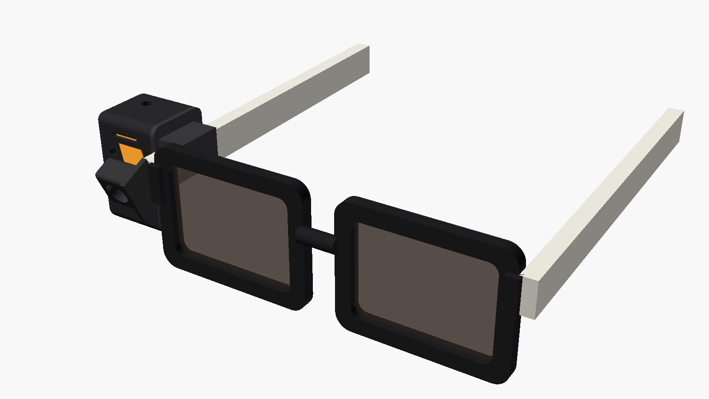
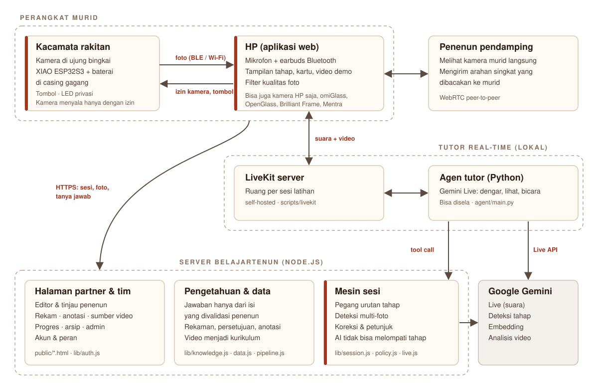
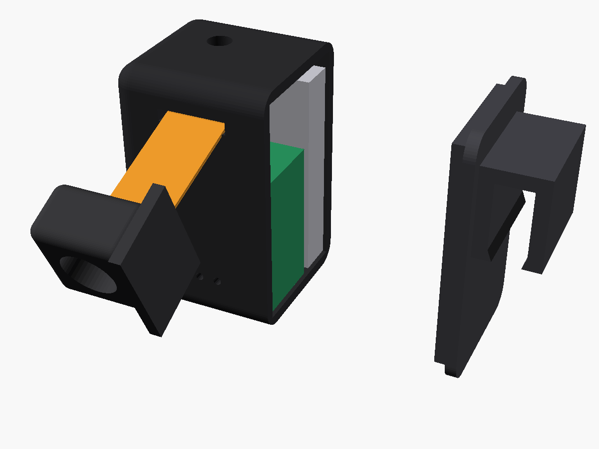
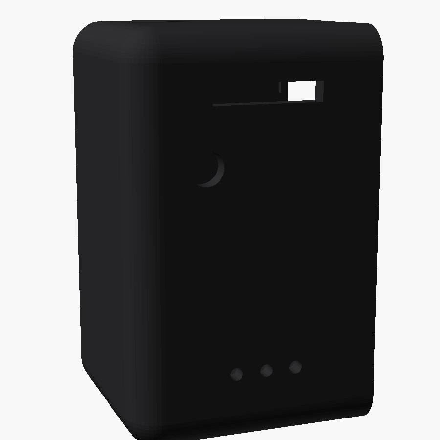
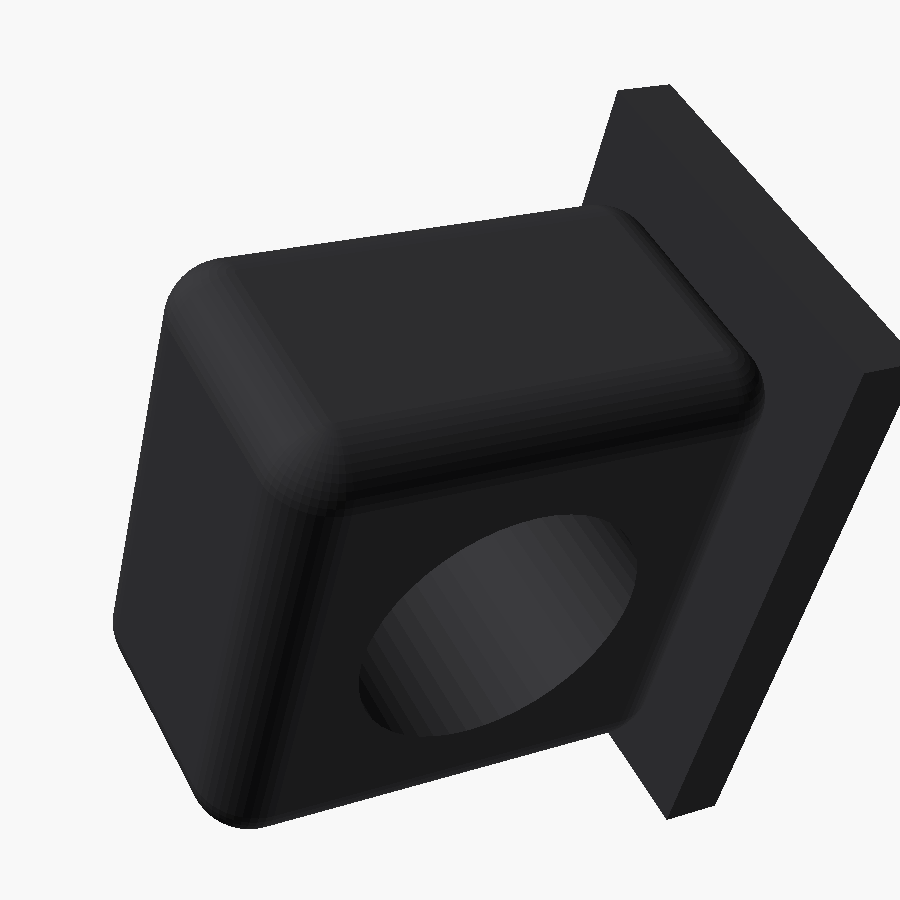
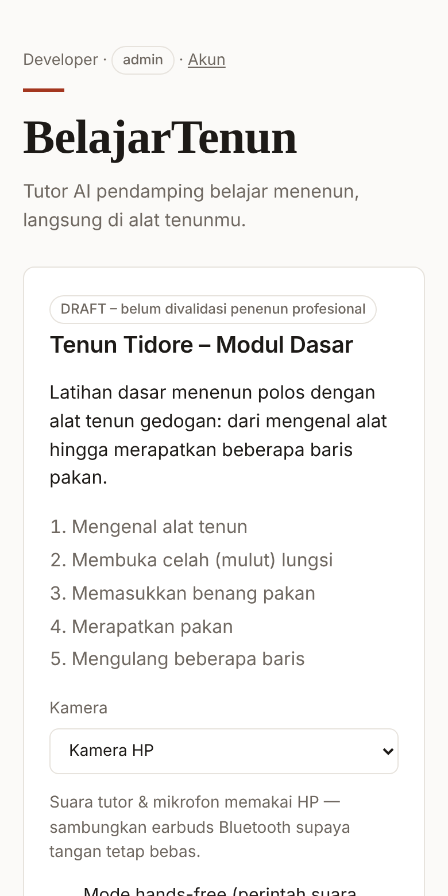
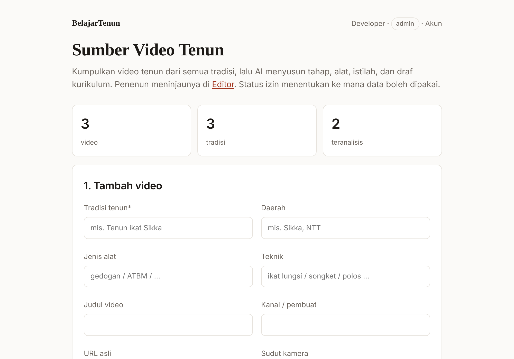
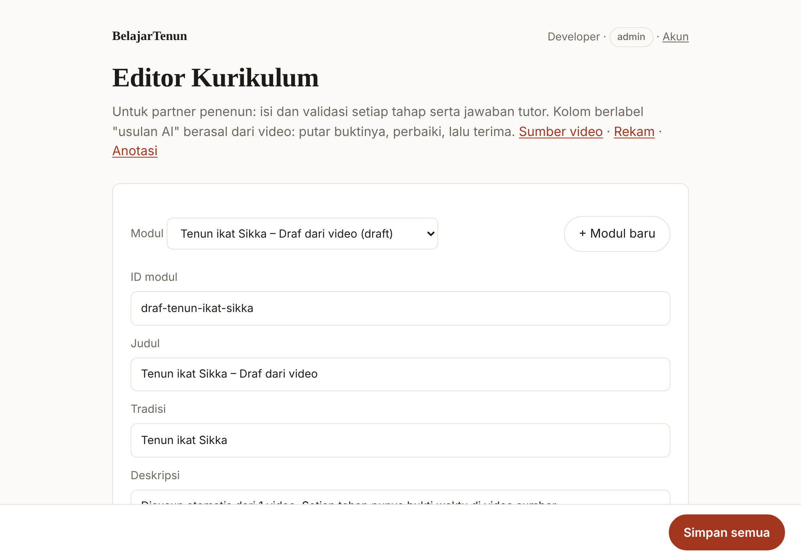
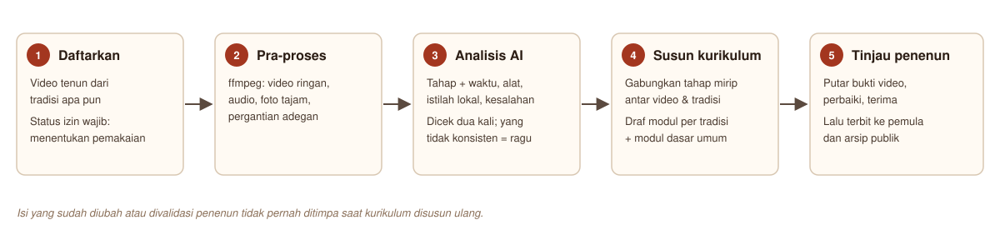

<p align="center">
  
</p>

<p align="center">
  Kacamata berkamera dan tutor AI yang membimbing pemula belajar menenun tradisional,<br>
  langsung di alat tenun, berdasarkan pengetahuan yang divalidasi penenun.
</p>

<p align="center">
  <a href="#cara-kerja">Cara kerja</a> ·
  <a href="#kacamata">Kacamata</a> ·
  <a href="#aplikasi">Aplikasi</a> ·
  <a href="#mulai-cepat">Mulai cepat</a> ·
  <a href="#dari-video-ke-data-belajar">Video ke data</a> ·
  <a href="#struktur-repositori">Struktur</a> ·
  <a href="#status">Status</a>
</p>

<p align="center">
  
</p>

## Tentang

Belajar menenun biasanya butuh guru yang mendampingi langsung, dan jumlah penenun ahli terus berkurang. BelajarTenun membantu pemula berlatih sendiri tanpa kehilangan pakem tradisinya.

- **Melihat dari sudut pandang penenun.** Kamera kecil di ujung bingkai kacamata melihat tangan, lungsi, dan pakan.
- **Membimbing dengan suara.** Tutor memberi instruksi tiap tahap, mengenali kapan tahap selesai, mengoreksi kesalahan, dan menjawab pertanyaan. Murid bisa menyela kapan saja, dan tangan tetap bebas.
- **Hanya menjawab dari pengetahuan yang divalidasi.** Isi kurikulum, makna motif, dan pakem berasal dari penenun, bukan karangan AI.
- **Penenun tetap terlibat.** Penenun senior bisa memantau murid dari jauh, memvalidasi kurikulum, dan mengizinkan atau mencabut pemakaian rekamannya.

Modul pertama: **Tenun Tidore, modul dasar** (5 tahap, masih draf). Alur video ke data mendukung **semua tradisi tenun**.

## Cara kerja

<p align="center">
  
</p>

1. **Kacamata** mengirim foto dari kamera ke HP lewat Bluetooth (atau Wi-Fi). Kamera hanya menyala setelah aplikasi memberi izin, dan LED privasi menyala selama kamera aktif.
2. **HP** menjalankan aplikasi web. Mikrofon dan suara tutor memakai HP dengan earbuds Bluetooth.
3. **Tutor real-time**: HP tersambung ke server LiveKit lokal. Agen tutor di server menjalankan Gemini Live untuk mendengar, melihat, dan berbicara.
4. **Mesin sesi** di server memegang urutan tahap kurikulum. AI hanya bisa memajukan tahap lewat aturan yang jelas: konfirmasi murid, atau deteksi kamera yang lolos dua kali berturut-turut.
5. **Pengetahuan & data**: jawaban hanya diambil dari isi yang divalidasi penenun. Rekaman dan video tenun diolah menjadi kurikulum baru.

Pola arsitektur tutornya mengikuti [VisionClaw](https://github.com/sseanliu/VisionClaw), protokol kamera kacamata mengikuti [OpenGlass](https://github.com/BasedHardware/OpenGlass) dan [omiGlass](https://github.com/BasedHardware/omi/tree/main/omiGlass), dan cara tutor memutuskan kapan berbicara mengikuti riset [Watch, Talk and Guide](https://github.com/sled-group/Watch-Talk-and-Guide).

## Kacamata

Kacamata BelajarTenun dirakit sendiri dari kacamata biasa. **Modul kamera** ditempel di ujung bingkai menghadap ke depan dan menunduk 25° supaya tangan dan lungsi terlihat. Modul kamera tersambung lewat kabel pita ke **casing di gagang** yang berisi XIAO ESP32S3 Sense dan baterai.

| Casing dan isinya | Casing tampak depan | Dudukan kamera |
|:---:|:---:|:---:|
|  |  |  |
| XIAO (hijau), baterai (abu), kabel kamera (oranye), tutup dengan penjepit gagang | Celah kabel kamera, LED privasi, lubang mikrofon | Ditempel di ujung bingkai, lensa menunduk 25° |

**Komponen utama:** Seeed Studio XIAO ESP32S3 Sense, baterai LiPo 250 mAh (EEMB LP502030), satu tombol, satu LED, dua resistor, dan casing cetak 3D. Daftar lengkap dan skema kabel ada di [`hardware/README.md`](hardware/README.md).

**Untuk MVP, kacamata hanya berisi kamera, tombol, dan LED.** Mikrofon dan suara memakai HP dengan earbuds. Hasilnya casing lebih kecil, baterai lebih awet, dan kualitas suara lebih baik. Varian dengan mikrofon dan speaker di kacamata tersedia sebagai casing v2.

| Bagian | Lokasi |
|---|---|
| Model 3D (OpenSCAD parametrik + STL siap cetak) | [`hardware/casing/`](hardware/casing/) |
| Firmware (PlatformIO, dikompilasi otomatis oleh CI) | [`firmware/belajartenun-glasses/`](firmware/belajartenun-glasses/) |
| Komponen, skema kabel, MVP dan v2 | [`hardware/README.md`](hardware/README.md) |

Tombol di kacamata: **ketuk** untuk lanjut ke tahap berikutnya, **ketuk dua kali** untuk mengulang instruksi, **tahan** untuk membekukan tampilan.

## Aplikasi

| Pemula (HP) | Sumber video (partner) | Editor kurikulum (partner) |
|:---:|:---:|:---:|
|  |  |  |

**Untuk pemula**

| Halaman | Isi |
|---|---|
| `/` | Latihan: pilih modul dan kamera (HP atau kacamata), lihat contoh, praktik, deteksi tahap, koreksi, tanya jawab, mode hands-free, kuesioner akhir |
| `/kacamata.html` | Mode kacamata: tampilan seperti di lensa, untuk kacamata BelajarTenun, omiGlass, atau OpenGlass |
| `/progres.html` | Progres latihan pribadi |

**Untuk penenun dan partner**

| Halaman | Isi |
|---|---|
| `/editor.html` | Menyusun dan memvalidasi kurikulum serta tanya jawab; kolom usulan AI bisa diperiksa dengan memutar bukti videonya |
| `/sumber.html` | Mendaftarkan video tenun dari tradisi apa pun, lalu menyusun draf kurikulum otomatis |
| `/rekam.html` | Merekam penenun dengan persetujuan yang bisa dicabut |
| `/anotasi.html` | Menandai tahap di video panjang dan mengekspor foto berlabel |
| `/pendamping.html` | Memantau kamera murid dari jauh dan mengirim arahan |

**Untuk tim:** `/arsip.html` (arsip tenun publik), `/admin.html` (akun dan pemakaian AI), `/masuk.html` (akun dan kode akses kacamata).

## Mulai cepat

Butuh Node.js 20 atau lebih baru. Tidak perlu `npm install`.

```bash
cp .env.example .env
```

```bash
node --env-file=.env server.js
```

Buka `http://localhost:3000`, lalu daftar. Pengguna pertama otomatis menjadi admin. Untuk mencoba tanpa akun:

```bash
npm run dev
```

Perintah ini mematikan login (semua pengguna dianggap admin), jadi jangan dipakai di produksi.

**Catatan:**
- Kamera dan Bluetooth di HP hanya berfungsi lewat HTTPS. Pakai deploy ([`docs/DEPLOY.md`](docs/DEPLOY.md)) atau tunnel seperti `ngrok http 3000`.
- Kacamata tersambung lewat Web Bluetooth, yang tersedia di Chrome Android dan desktop, tidak di iPhone.

### Dengan dan tanpa AI

| Tanpa `GEMINI_API_KEY` | Dengan `GEMINI_API_KEY` |
|---|---|
| Murid menekan atau mengucapkan "sudah" untuk lanjut | Tahap dikenali otomatis dari kamera |
| Tanya jawab mencocokkan kata kunci | Tanya jawab berdasarkan makna, dengan sumber |
| Suara dari browser | Tutor suara real-time (Gemini Live), bisa disela |
| Video bisa didaftarkan dan dipra-proses | Video dianalisis dan disusun menjadi kurikulum |

### Tutor real-time

Tutor suara real-time memakai server LiveKit yang dijalankan sendiri dan agen Python. Panduan lengkapnya ada di [`docs/LIVEKIT.md`](docs/LIVEKIT.md).

```bash
npm run livekit:setup
```

```bash
npm run livekit
```

```bash
npm run agent
```

## Dari video ke data belajar

<p align="center">
  
</p>

Setiap video punya **status izin** yang menentukan ke mana datanya boleh dipakai:

| Status izin | Analisis & draf kurikulum | Video demo untuk pemula | Melatih model | Video di arsip publik |
|---|:---:|:---:|:---:|:---:|
| `riset_internal` (video internet tanpa izin) | Ya | Tidak | Tidak | Tidak, hanya tautan |
| `cc_by`, `izin_tertulis`, `milik_sendiri` | Ya | Ya | Ya | Ya, dengan atribusi |

Rekaman partner mengikuti alur yang sama lewat `/rekam.html` dan `/anotasi.html`. Foto yang ditandai "berhasil" otomatis menjadi contoh untuk deteksi kamera, dan akurasinya bisa diukur dengan `npm run evaluate`.

## Struktur repositori

```
server.js                    Server HTTP: sesi, API kacamata, tutor, akun, data
lib/                         Logika server
  session.js · policy.js     Mesin sesi dan kapan tutor bicara
  live.js · livekit.js       Konfigurasi Gemini Live dan token LiveKit
  knowledge.js · data.js     Pengetahuan tervalidasi, rekaman, persetujuan
  sources.js · pipeline.js   Alur video menjadi kurikulum (beserta preprocess, video-analysis, alignment)
  auth.js · store.js · ai.js Akun, penyimpanan, akses Gemini
public/                      Aplikasi web (halaman, skrip, gaya)
agent/                       Agen tutor real-time (Python, LiveKit + Gemini Live)
firmware/                    Firmware kacamata (XIAO ESP32S3 Sense)
hardware/                    Casing 3D, komponen, skema kabel
clients/                     Klien untuk kacamata lain (Brilliant Frame, MentraOS)
scripts/                     Evaluasi, impor, pelatihan model, LiveKit
data/                        Kurikulum awal, pengetahuan, taksonomi alat & aksi
docs/                        Dokumentasi dan gambar
test/                        Tes otomatis (npm test)
```

## Perintah

| Perintah | Kegunaan |
|---|---|
| `npm start` | Menjalankan server |
| `npm run dev` | Server pengembangan tanpa login |
| `npm test` | Semua tes |
| `npm run livekit:setup`, `npm run livekit`, `npm run agent` | Tutor real-time lokal |
| `npm run evaluate` | Mengukur akurasi deteksi kamera |
| `npm run import-sources -- daftar.csv` | Mendaftarkan banyak video dari CSV |
| `npm run import-motif -- motif.csv --dataset "Nama"` | Mengimpor dataset motif ke pengetahuan (draf) |
| `npm run dialogs -- --module <id>` | Membuat dialog latihan sintetis dan menguji tutor |
| `npm run export-dataset` | Mengekspor foto berlabel untuk melatih model |

## Status

| Bagian | Status |
|---|---|
| Aplikasi web, mesin sesi, akun, data, alur video | Berjalan; 47 tes otomatis lolos |
| Firmware kacamata | Dikompilasi oleh CI; logika protokol dites; belum diuji di board asli |
| Casing 3D | STL siap cetak; belum dicetak dan dicoba |
| LiveKit lokal + agen | Diuji sampai agen bergabung ke ruang |
| Fitur yang memakai Gemini (deteksi, Live, analisis video) | Belum diuji dengan API key asli |
| Isi kurikulum dan pengetahuan | Draf; wajib divalidasi penenun tiap tradisi |

## Dokumentasi

| Dokumen | Isi |
|---|---|
| [`hardware/README.md`](hardware/README.md) | Komponen, skema kabel, MVP dan v2 |
| [`hardware/casing/README.md`](hardware/casing/README.md) | Mencetak dan merakit casing |
| [`firmware/belajartenun-glasses/README.md`](firmware/belajartenun-glasses/README.md) | Firmware dan protokol Bluetooth |
| [`docs/LIVEKIT.md`](docs/LIVEKIT.md) | Tutor real-time lokal |
| [`docs/KACAMATA.md`](docs/KACAMATA.md) | API kacamata dan perangkat yang didukung |
| [`docs/DEPLOY.md`](docs/DEPLOY.md) | Deploy ke Google Cloud Run |
| [`docs/PRIVASI.md`](docs/PRIVASI.md) | Privasi, persetujuan, dan keamanan |
| [`docs/PANDUAN-ANOTASI.md`](docs/PANDUAN-ANOTASI.md) | Panduan merekam dan menandai untuk partner |

## Terima kasih

BelajarTenun dibangun di atas proyek terbuka: [OpenGlass](https://github.com/BasedHardware/OpenGlass) dan [omiGlass](https://github.com/BasedHardware/omi/tree/main/omiGlass) (hardware dan protokol kamera), [VisionClaw](https://github.com/sseanliu/VisionClaw) (pola tutor real-time), [LiveKit](https://github.com/livekit/livekit) (server media), [Watch, Talk and Guide](https://github.com/sled-group/Watch-Talk-and-Guide), [HowToDIV](https://github.com/google/howtodiv), dan [EgoExoLearn](https://github.com/OpenGVLab/EgoExoLearn) (riset panduan tugas dari video), serta [RIO](https://github.com/mk14ray/RIO-XIAO-ESP32-S3-Gemini-Live-Voice-Assistant) dan [vision-assist](https://github.com/RoboX2020/vision-assist) (kacamata dengan AI real-time).

Pengetahuan tentang tenun adalah milik para penenun dan komunitasnya.
