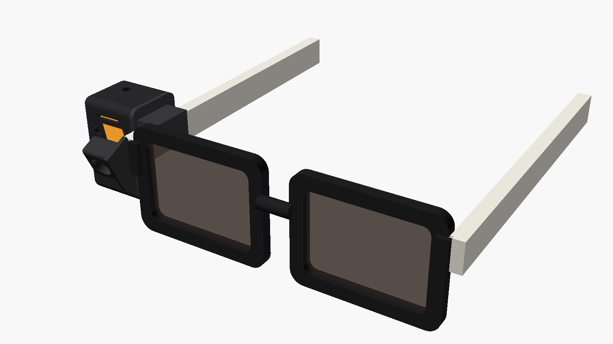

# Hardware Kacamata BelajarTenun

## Rekomendasi untuk MVP: kacamata hanya kamera, suara di HP

<p align="center"></p>

Modul kamera ditempel di ujung bingkai menghadap ke depan, tersambung kabel pita ke casing di gagang yang berisi XIAO ESP32S3 dan baterai. Foto dikirim ke HP lewat Bluetooth (atau Wi-Fi). Mikrofon dan suara tutor memakai HP dengan earbuds Bluetooth. Gambaran sistem lengkapnya ada di [README utama](../README.md#cara-kerja).

| | **MVP (disarankan)** | v2: mik + speaker di kacamata |
|---|---|---|
| Di kacamata | Kamera, 1 tombol, LED privasi | + mik PDM bawaan Sense, amplifier MAX98357A, speaker 15 mm |
| Suara tutor & mik | HP + earbuds Bluetooth | Langsung di kacamata (WebSocket audio ke server) |
| Ukuran casing | ±23 × 22 × 37 mm + dudukan kamera | ±23 × 27 × 43 mm + dudukan kamera |
| Baterai 250 mAh | Lebih awet (ESP32 hanya kamera) | Lebih boros (audio + Wi-Fi terus-menerus) |
| Kualitas suara | Bagus (peredam gema & bising HP, earbuds) | Perlu peredam gema di ESP32 (lihat proyek RIO) |
| Privasi sekitar | Tidak terdengar orang lain | Speaker terdengar orang di sekitar |
| Status di repo | Firmware, casing, dan aplikasi sudah ada | Casing sudah ada (`with_speaker=true`); firmware audio belum dibuat |

Alasannya: casing lebih kecil dan ringan, baterai lebih awet, dan kualitas suara jauh lebih baik. Arsitektur ini juga sudah jalan end-to-end di repo ini (LiveKit + Gemini Live memakai mik HP). Pola yang sama dipakai [vision-assist](https://github.com/RoboX2020/vision-assist). Pindah ke v2 bila pengguna merasa earbuds mengganggu.

## Daftar komponen (MVP)
| Komponen | Jumlah | Catatan |
|---|---|---|
| Seeed Studio XIAO ESP32S3 **Sense** | 1 | Termasuk kamera OV2640/OV3660 + board ekspansi |
| LiPo 3,7 V 250 mAh (EEMB LP502030) | 1 | 5 × 20 × 30 mm; ada sirkuit proteksi |
| Tombol taktil 6 × 6 mm | 1 | Ke D0 (GPIO1) dan GND |
| LED 3 mm (merah/putih) + resistor 330 Ω | 1 | LED privasi ke D2 (GPIO3) |
| Resistor 100 kΩ | 2 | Pembagi tegangan baterai ke D1 (GPIO2) |
| Kabel tipis 30 AWG, isolasi Kapton, lem | – | |
| Casing cetak 3D | 1 set | `casing/body.stl`, `casing/lid.stl`, `casing/camera.stl` |
| Kacamata biasa | 1 | Gagang ±5 × 11 mm dekat engsel (ubah `temple_t/h` bila berbeda) |
| Earbuds Bluetooth | 1 | Untuk suara tutor (di HP) |

Tambahan v2: amplifier I2S **MAX98357A**, speaker mikro 15 mm 8 Ω 1 W, dan casing `casing/*-v2-speaker.stl`.

## Skema kabel (MVP)
```
XIAO ESP32S3            Komponen
 BAT+ ──────────────── LiPo +   (pad baterai di bawah board)
 BAT- ──────────────── LiPo −
 D0 / GPIO1 ────────── tombol ──── GND
 D1 / GPIO2 ────┬───── 100 kΩ ──── BAT+
                └───── 100 kΩ ──── GND
 D2 / GPIO3 ────────── 330 Ω ──── LED (+)  LED (−) ──── GND
```
Pin ini diatur di `firmware/belajartenun-glasses/src/config.h`. Kamera dan mikrofon sudah tersambung di board Sense.

## Langkah membuat
1. Cetak badan, tutup, dan dudukan kamera (`hardware/casing/`, baca README di sana).
2. Solder baterai, tombol, LED, dan pembagi tegangan sesuai skema.
3. Unggah firmware (`firmware/belajartenun-glasses/`).
4. Pasang modul kamera di dudukannya dan tempel ke ujung bingkai; masukkan board dan baterai ke casing, lalu jepitkan ke gagang.
5. Buka aplikasi BelajarTenun di **Chrome Android**, pilih kamera **"Kacamata BelajarTenun"**, sambungkan earbuds, lalu mulai latihan.

## Diambil dari proyek terbuka
| Proyek | Yang dipakai |
|---|---|
| [omiGlass (penerus OpenGlass)](https://github.com/BasedHardware/omi/tree/main/omiGlass) · MIT | UUID & format potongan foto BLE, pola manajemen daya, deep sleep dengan tombol, ukuran casing |
| [OpenGlass](https://github.com/BasedHardware/OpenGlass) · MIT | Konsep casing kotak + tutup samping, komponen |
| [RIO – Gemini Live di XIAO](https://github.com/mk14ray/RIO-XIAO-ESP32-S3-Gemini-Live-Voice-Assistant) · MIT | Kamera hanya menyala setelah izin, aturannya dikunci di firmware; acuan untuk audio v2 |
| [vision-assist](https://github.com/RoboX2020/vision-assist) · MIT | Arsitektur MVP: kamera di kacamata, suara di HP + earbuds |
| [xiao-esp32s3-vision](https://github.com/Arun-Raj-C-R/xiao-esp32s3-vision) | Mode Wi-Fi `GET /capture`, `CAMERA_GRAB_LATEST`, `WiFi.setSleep(false)`, buang foto basi |
| [ai-glasses-research](https://github.com/shanhtetsan/ai-glasses-research) · MIT | Pemulihan otomatis kamera/koneksi, laporan status; acuan WebSocket audio v2 |
