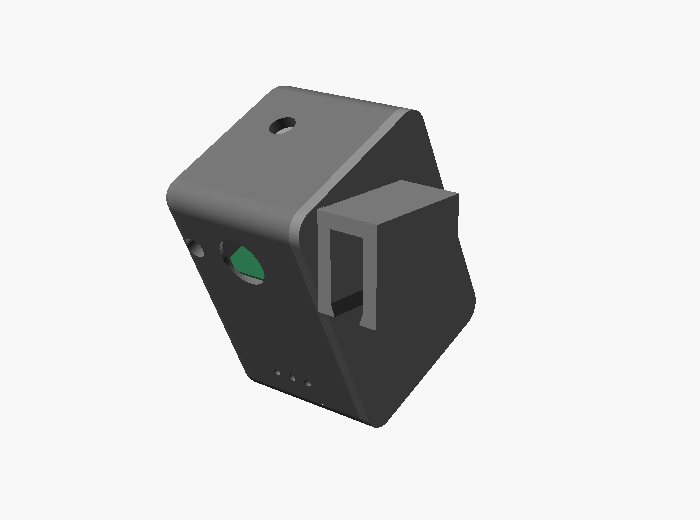
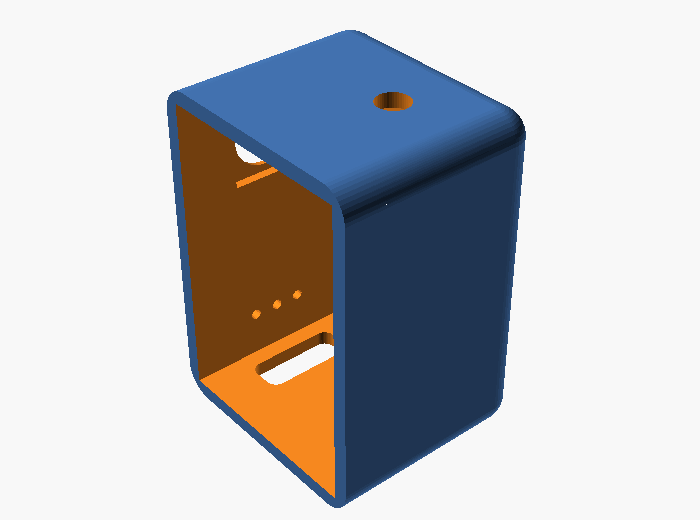
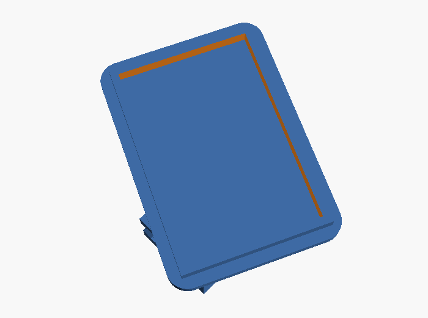

# Casing Kacamata BelajarTenun

Casing 3D untuk memasang **Seeed Studio XIAO ESP32S3 Sense** dan baterai **LiPo 502030 (250 mAh)** di engsel depan kacamata biasa. Konsepnya mengikuti casing OpenGlass (kotak + tutup samping), dengan penyesuaian untuk menenun.

| Rakitan | Badan | Tutup + penjepit |
|---|---|---|
|  |  |  |

## Isi folder
| Berkas | Keterangan |
|---|---|
| `belajartenun_casing.scad` | Model parametrik OpenSCAD (sumber utama, ubah ukuran di sini) |
| `body.stl` | Badan casing, siap cetak (posisi berdiri, sisi terbuka ke samping) |
| `lid.stl` | Tutup + penjepit gagang, siap cetak (rebah) |

## Bedanya dengan casing OpenGlass
- **Kamera menunduk 25°** (`camera_tilt`) supaya tangan, lungsi, dan pakan terlihat saat menenun. OpenGlass menghadap lurus ke depan.
- **Penjepit gagang** (`mount = "clip"`) dengan bibir pengunci, jadi casing bisa dilepas dan tidak perlu lem. Untuk gaya OpenGlass (sirip dilem), pakai `mount = "tab"`.
- **Lubang LED privasi** 3 mm di sebelah lensa (wajib menyala saat kamera aktif), **lubang tombol** di atas, **lubang mikrofon**, dan **lubang USB-C** di bawah untuk mengisi daya.
- **Kantong modul kamera** di dinding depan supaya lensa tidak goyang.

## Ukuran
- Luar badan ±23 × 26 × 37 mm (tanpa penjepit), sebanding dengan OpenGlass (±41 × 25 × 36 mm termasuk tutup).
- Rongga dalam: XIAO + board Sense + kamera (17,8 × 21 × 15 mm) di depan, baterai berdiri di belakang.

**Ukur komponenmu dulu** sebelum mencetak. Ukuran yang paling sering berbeda:
- `stack_d`: tebal tumpukan XIAO + Sense + kamera
- `usb_y`: posisi port USB-C dari dinding depan
- `lens_z`: tinggi lensa kamera
- `temple_t` / `temple_h`: tebal dan tinggi gagang kacamatamu di dekat engsel

## Cara membuat STL
Ubah parameter di bagian atas `.scad`, lalu:
```bash
openscad -D 'part="body"' -o body.stl belajartenun_casing.scad
```
```bash
openscad -D 'part="lid"' -o lid.stl belajartenun_casing.scad
```
Pratinjau rakitan: buka `.scad` di OpenSCAD (part `"assembly"`). Warna hijau = board, abu-abu muda = baterai.

## Pengaturan cetak (saran)
- Bahan **PETG** (lebih tahan panas dan lentur untuk penjepit) atau PLA.
- Layer 0,2 mm, dinding 3 garis, infill 30–40%.
- Badan dicetak berdiri dengan sisi terbuka ke samping; tutup dicetak rebah. Lubang lensa dan USB di dinding vertikal tidak butuh support. Penjepit mungkin butuh support kecil, tergantung kemiringan.
- Cetak percobaan dulu, lalu sesuaikan `tol` (kelonggaran, default 0,4 mm) dan `temple_t`.

## Merakit
1. Pasang kamera ke board Sense, lalu dorong modul kamera ke kantong lensa di dinding depan (beri sedikit lem bila longgar).
2. Masukkan XIAO berdiri di bagian depan dengan port USB-C menghadap lubang bawah.
3. Solder baterai ke pad BAT+/BAT− di bawah XIAO, lalu letakkan baterai di belakang sekat. Tambahkan isolasi Kapton di antara baterai dan board.
4. (Opsional) Pasang tombol taktil 6×6 di bawah lubang atas dan LED 3 mm + resistor di lubang LED, sambungkan ke GPIO (lihat firmware).
5. Tekan tutup sampai bibirnya masuk, lalu jepitkan ke gagang kacamata dekat engsel, sisi kamera menghadap ke depan.

⚠️ LiPo: jangan tertusuk, tertekuk, atau terjepit; jangan dicas tanpa pengawasan di dalam casing tertutup saat pertama kali diuji.
