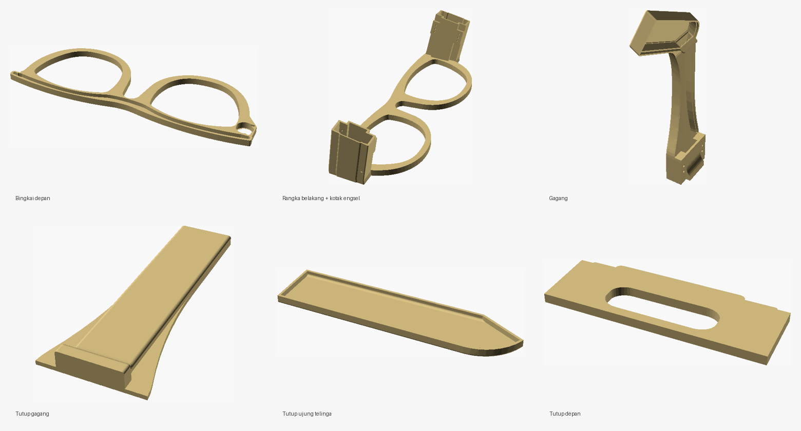

# Kacamata omiGlass

Kacamata cetak 3D utuh (bingkai, rangka belakang dengan kotak di dekat engsel, gagang, dan tutup-tutupnya) untuk Seeed Studio XIAO ESP32S3 Sense dan baterai LiPo 250 mAh, komponen yang sama dengan BelajarTenun. Ini desain terbaru dari tim OpenGlass, penerus [case klip lama](../openglass-case/).

## Asal dan lisensi

Semua file di folder ini **bukan buatan BelajarTenun**. Disalin tanpa perubahan dari proyek omiGlass karya Based Hardware Contributors:

- Sumber: [`BasedHardware/omi` → `omiGlass/hardware/`](https://github.com/BasedHardware/omi/tree/main/omiGlass/hardware), commit `ed4bfcf`
- Dokumentasi asli: [docs.omi.me/doc/hardware/omiGlass](https://docs.omi.me/doc/hardware/omiGlass)
- Lisensi: MIT, salinan lengkap di [`LICENSE`](LICENSE). Copyright 2024 Based Hardware Contributors.

Nama file diganti supaya tanpa spasi; isinya identik byte per byte dengan file asli.

| File di sini | Nama asli | Ukuran (mm) |
|---|---|---|
| `frame-front.stl` | `front.step.stl` | 154,9 × 51,4 × 4,1 |
| `frame-back.stl` | `Frame_Back_v5.stl.stl` | 51,4 × 163,4 × 40,0 |
| `leg-left.stl` / `leg-right.stl` | `Left Leg.STL.stl` / `Right Leg.STL.stl` | 13,6 × 66,3 × 116,6 |
| `leg-cover-left.stl` / `leg-cover-right.stl` | `Left leg Cover.STL.stl` / `Right Leg cover.STL.stl` | 24,4 × 58,5 × 5,2 |
| `ear-cover-left.stl` / `ear-cover-right.stl` | `Left Leg ear cover.STL.stl` / `Right Leg ear cover.STL.stl` | 64,7 × 14,7 × 2,4 |
| `front-cover-left.stl` / `front-cover-right.stl` | `Assem1 - Front assembly-1 Frontt Cover Left-1_PCBWay Community.STL.stl` / `... Front Cover Right-1 ...` | 23,2 × 8,0 × 1,0 |
| `temple-cover-left.stl` / `temple-cover-right.stl` | `Assem1 - Left Temple Assembly-1 Left temple Cover 3-1_PCBWay Community.STL.stl` / `... Right Temple Cover 3-1 ...` | 23,0 × 4,2 × 1,0 |
| `step/frame-front.step` | `working files/glasses_frame_front.step` | File CAD untuk diedit |
| `step/frame-back.step` | `working files/glasses_frame_back.step` | File CAD untuk diedit |

Catatan: `temple-cover-*.stl` hanya berisi 12 segitiga (pelat datar sederhana). Disalin apa adanya; periksa dulu sebelum dicetak.

## Mencetak dan merakit

Ikuti panduan asli di dokumentasi omiGlass. Ringkasnya: cetak semua bagian (PLA/PETG), pasang engsel kacamata standar, masukkan XIAO dan baterai ke kotak, lalu tutup.

## Penyesuaian untuk BelajarTenun

Desain asli tidak punya lubang untuk **tombol 6 × 6 mm** (D0/GPIO1) dan **LED privasi 3 mm** (D2/GPIO3) yang dipakai firmware BelajarTenun. Bisa dibor manual, atau ubah file STEP di Fusion 360 / FreeCAD.
