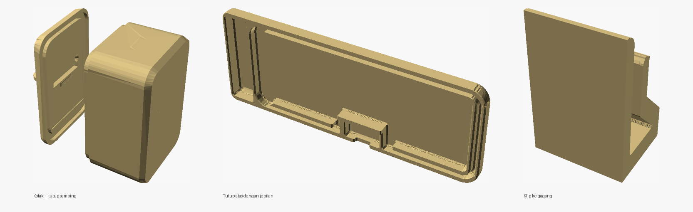

# Case klip OpenGlass

Kotak samping yang dijepitkan ke gagang kacamata apa saja. Berisi Seeed Studio XIAO ESP32S3 Sense (kamera menempel di board, menghadap ke depan) dan baterai LiPo 250 mAh, komponen yang sama dengan BelajarTenun.

## Asal dan lisensi

Semua file di folder ini **bukan buatan BelajarTenun**. Diambil tanpa perubahan dari proyek OpenGlass karya Based Hardware Contributors, yang sekarang disimpan di repo Omi:

- Sumber: [`BasedHardware/omi` → `omiGlass/hardware/openglass-old/`](https://github.com/BasedHardware/omi/tree/main/omiGlass/hardware/openglass-old), commit `ed4bfcf`
- Proyek asal: [BasedHardware/OpenGlass](https://github.com/BasedHardware/OpenGlass) (sudah tidak dirawat, pindah ke repo Omi)
- Lisensi: MIT, salinan lengkap di [`LICENSE`](LICENSE). Copyright 2024 Based Hardware Contributors.

| File di sini | Nama asli | Ukuran (mm) | Isi |
|---|---|---|---|
| `case.stl` | `old_openglass_case.stl` | 40,7 × 24,5 × 36,0 | Kotak + tutup samping |
| `top-with-clip.stl` | `Top with clip.stl` | 67,0 × 14,1 × 25,0 | Tutup atas dengan jepitan |
| `clip.stl` | `Clip.stl` | 14,0 × 11,1 × 22,0 | Klip ke gagang |

Nama file diganti supaya tanpa spasi; isinya identik byte per byte dengan file asli.

## Mencetak

- PLA atau PETG, layer 0,2 mm, infill 20%. Bagian kotak sebaiknya dicetak dengan sisi terbuka menghadap ke atas.
- Ukuran di atas adalah kotak pembatas tiap file. Gambar di atas tidak berskala sama.

## Penyesuaian untuk BelajarTenun

Desain asli tidak punya lubang untuk **tombol 6 × 6 mm** (D0/GPIO1) dan **LED privasi 3 mm** (D2/GPIO3) yang dipakai firmware BelajarTenun. Sampai varian dengan lubang tersebut tersedia:

- bor lubang 3 mm untuk LED di sisi depan kotak, dan
- tempel tombol di luar kotak (kabel lewat celah tutup), atau bor lubang 6 mm.

Desain casing BelajarTenun sendiri (kamera terpisah di ujung bingkai, sudah ada lubang tombol dan LED) tetap tersedia di [`../casing/`](../casing/) sebagai alternatif.
